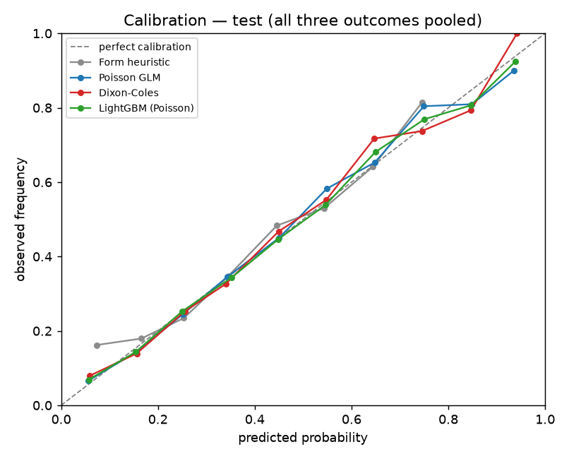
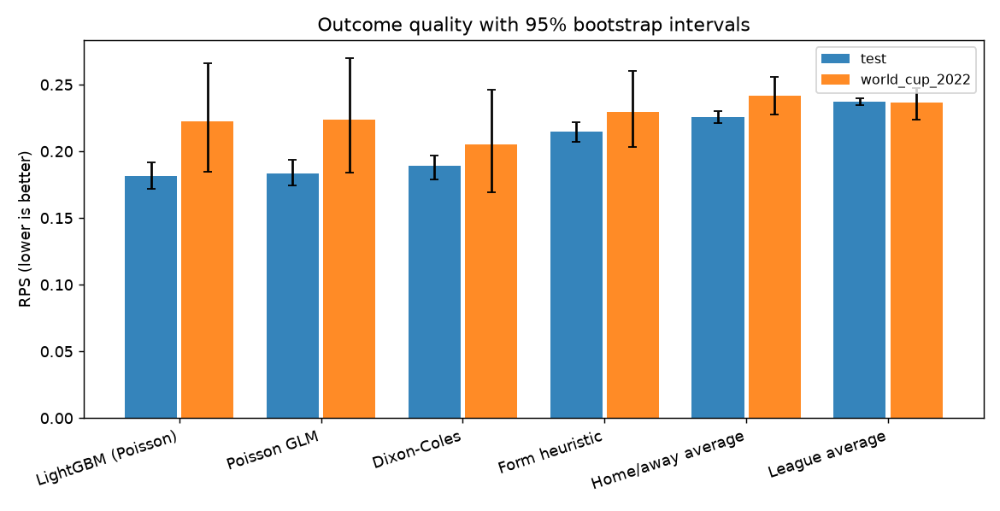
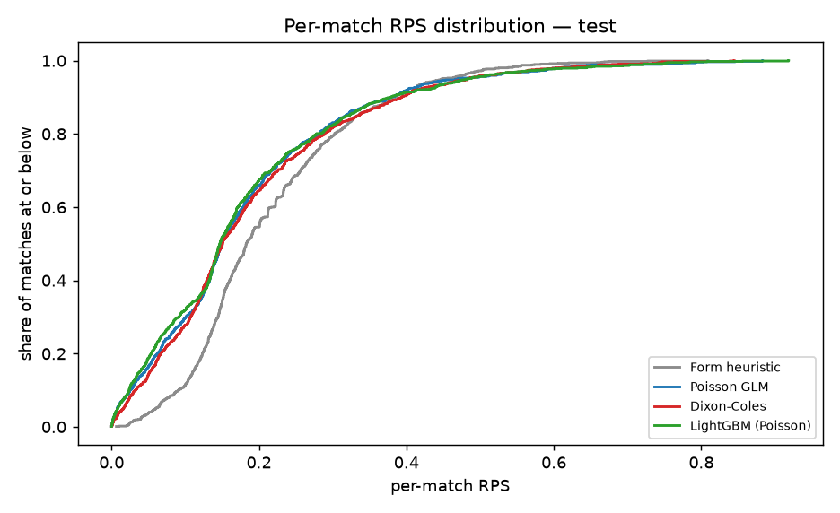
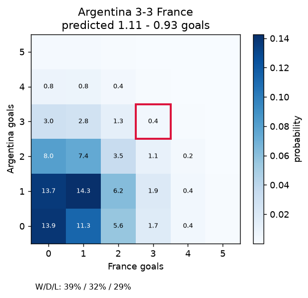

# Results

## Setup

- 49,939 matches, 1872-11-30 to 2026-10-06.
- Split: train <= 2017, validation 2018-2021, test 2022. Never shuffled.
- Features are point-in-time; Elo and rolling form are read before kick-off.
- Intervals are 300-resample percentile bootstraps, resampling **matches** (not team-rows).

## Headline: 2022 test block

| Model | Matches | RPS | Log loss | Accuracy | MAE (goals) |
| --- | --- | --- | --- | --- | --- |
| LightGBM (Poisson) | 970 | 0.181 [0.172, 0.192] | 0.909 [0.870, 0.945] | 0.579 [0.546, 0.613] | 0.907 |
| Poisson GLM | 970 | 0.183 [0.174, 0.194] | 0.916 [0.881, 0.954] | 0.579 [0.547, 0.612] | 0.897 |
| Dixon-Coles | 970 | 0.189 [0.179, 0.197] | 0.934 [0.899, 0.970] | 0.574 [0.537, 0.609] | 0.898 |
| Form heuristic | 970 | 0.215 [0.207, 0.222] | 1.016 [0.987, 1.040] | 0.505 [0.474, 0.536] | 0.964 |
| Home/away average | 970 | 0.226 [0.221, 0.230] | 1.042 [1.026, 1.058] | 0.498 [0.472, 0.528] | 1.028 |
| League average | 970 | 0.237 [0.234, 0.240] | 1.072 [1.062, 1.082] | 0.275 [0.249, 0.302] | 1.077 |

Lower is better for RPS, log loss and MAE. Accuracy is reported with its interval because on a few hundred matches the differences between the fitted models are usually inside the noise.

## The 2022 World Cup only

| Model | Matches | RPS | Log loss | Accuracy | MAE (goals) |
| --- | --- | --- | --- | --- | --- |
| Dixon-Coles | 64 | 0.205 [0.169, 0.246] | 1.006 [0.898, 1.138] | 0.562 [0.438, 0.672] | 0.974 |
| LightGBM (Poisson) | 64 | 0.223 [0.185, 0.266] | 1.052 [0.921, 1.186] | 0.484 [0.359, 0.609] | 0.969 |
| Poisson GLM | 64 | 0.224 [0.184, 0.270] | 1.059 [0.923, 1.218] | 0.500 [0.375, 0.625] | 0.987 |
| Form heuristic | 64 | 0.230 [0.203, 0.260] | 1.075 [0.980, 1.173] | 0.422 [0.297, 0.547] | 0.981 |
| League average | 64 | 0.236 [0.224, 0.248] | 1.075 [1.034, 1.120] | 0.328 [0.219, 0.469] | 1.076 |
| Home/away average | 64 | 0.242 [0.227, 0.256] | 1.091 [1.056, 1.129] | 0.438 [0.312, 0.547] | 1.047 |

## Charts

Calibration. A model on the diagonal is honest about its confidence; above it, underconfident; below it, overconfident.

RPS by model with 95% intervals. Overlapping intervals mean the ranking is not resolved.

Per-match RPS distribution. Further left is better on the typical match.

A worked example: the predicted scoreline distribution with the actual result outlined.

The example uses **Dixon-Coles**: Argentina vs France, predicted 1.11 - 0.93 against an actual 3-3.

## What these results do and do not say

- The fitted models beat every baseline on Poisson deviance, which is the goal-level loss they are trained on.
- On outcome metrics the fitted models are close to each other. With a small tournament sample, a 2-3 point RPS gap is not a reliable ordering; the intervals overlap by design.
- Boosting does not automatically win. When the underlying relationship is close to multiplicative, an additive log-linear model already captures most of it and a tree ensemble pays for flexibility in variance.
- Nothing here is a betting edge. The model prices matches; it does not know about injuries, travel, squad rotation or motivation.
